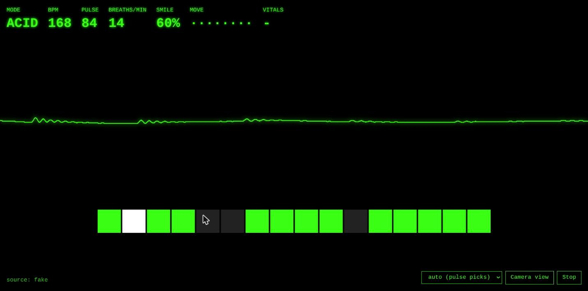

*This is a submission for the [Presage SmartSpectra SDK Challenge](https://dev.to/challenges/presage-2026-11-04)*

This article provides a step by step guide to Retro Techno Generator, a music toy built on the Presage SmartSpectra SDK for Node.js. A webcam reads your pulse, breathing and facial expressions, and a browser page turns them into 90s acid techno and hardcore with Web Audio. Every sound is synthesised; there are no samples.

https://github.com/xbill9/retro-techno-generator

**Your pulse sets the tempo and picks the style, your face plays the lead, and your dancing opens the filters.** Pulse and breathing need you to hold still, and the music asks you to move, so the app makes the two take turns: dance and the movement drives the sound, freeze for a few seconds and it re-reads your pulse. A hard dance raises your pulse, and the next still moment pushes the tempo up.

---

## What I Built

A Node server runs a SmartSpectra session on the local camera and streams the signals over a WebSocket to a page on `localhost`. The page is the instrument: a 16-step sequencer, a 303-style acid line, drum synthesis, pads, piano stabs and a hoover, all built from Web Audio oscillators and filters.

| Signal | What it plays |
| :--- | :--- |
| Pulse | Tempo is pulse × 2, held between 100 and 190 BPM. Below about 70: ambient pads. 70 to 90: acid techno. Above about 90: early-90s hardcore breaks and piano stabs |
| Movement | Opens the master filter, brightens the acid line and doubles the hi-hats |
| Breathing waveform | Sways the master filter while you are still |
| Smile | Opens the acid filter and switches to a major key |
| Surprise | Fires a hoover synth |
| Blink | Stutters the drums and tears the visuals |
| Talking | Pitched-up formant "vocal" chops |



The style switch has 3 BPM of hysteresis at each edge, so a pulse sitting at 70 does not flip between ambient and acid every bar. A dropdown overrides the pulse-picked style for anyone who wants to stay in hardcore.

---

## Demo

PENDING: demo video link.

---

## Code

https://github.com/xbill9/retro-techno-generator

MIT licence. Setup is in the README and below.

#### At this point you should have…

- Node 20 or later on Linux x64/arm64, macOS Apple Silicon or Windows x64
- A webcam and a desk lamp you can point at your face
- A free SmartSpectra API key from https://physiology.presagetech.com/auth/register

#### Step 1 — Install and Run

```bash
git clone https://github.com/xbill9/retro-techno-generator
cd retro-techno-generator
npm install
echo "SMARTSPECTRA_API_KEY=your-key" > .env
npm start
```

```text
Retro Techno Generator on http://localhost:8080 (live camera)
```

Open http://localhost:8080 and press Start. `npm run fake` runs the whole synth with sliders in place of the camera and needs no key, which is the quickest way to hear it.

#### Step 2 — Pick a Camera

```bash
node server.js --list-cameras
```

Set `CAMERA=<id>` in `.env` to use a camera other than the default.

---

## How It Responds to Human Signals

#### Step 3 — Open the SmartSpectra Session

The server creates the session when the page sends `start`, and requests breathing, cardio and face metrics in one session:

```javascript
sdk = new S.SmartSpectraSDK({
  apiKey: KEY,
  requestedMetrics: [...S.breathingMetrics, ...S.cardioMetrics, ...S.faceMetrics],
  enableTelemetry: false,
});
sdk.on('metrics', (buf) => onMetrics(S.decodeMetrics(buf)));
sdk.on('validationStatus', (code, _ts, hint) => broadcast({ type: 'status', code, hint }));
sdk.on('videoOutput', onVideo);
sdk.useCamera(S.CameraSelection.default);
sdk.start();
```

`onMetrics` takes the latest pulse rate, breathing rate and upper-chest breathing trace, the blink and talking flags, and the expression scores, and sends them to the page as one small JSON message. On Stop the server calls `stopAsync()` and then `destroy()`, which turns the camera off.

#### Step 4 — Show the Person Where to Stand

The SDK measures only when it can see your face and upper chest, lit from the front, and it reports what is wrong through `validationStatus` codes. With a face in view and the chest below the frame it repeats this every frame:

```text
VALID 16 Move up, or tilt the camera down.
VALID 7 Place more of the chest in view.
```

A status line is easy to miss when you cannot see yourself, so the page has a mirror view. The SDK's `videoOutput` event delivers each processed frame, 1280×720 RGB at 30 frames per second on this laptop's camera:

```text
VO 2764800 1280 720 3840 0
video frames 149
```

The server shrinks every third frame or so to 320×180 and sends about ten a second as a binary WebSocket message. The page draws it mirrored, with a dashed head-and-shoulders outline, a border that is red until you are in position, yellow while the first readings arrive and green once they flow, and one large instruction mapped from the SDK code:

| Code | SDK name | On screen |
| :--- | :--- | :--- |
| 5 | `kTooDark` | Too dark. Put a light in front of you |
| 7 | `kChestNotVisible` | ⬇ Show your shoulders: lean back or tilt the screen forward |
| 12 | `kExcessiveMotion` | Moving. Freeze for a few seconds to re-read pulse |
| 16 | `kFaceTooLow` | ⬆ Move up, or tilt the screen forward |

After the first good reading the preview shrinks to a corner thumbnail and stays there, so dancing does not bring the full panel back. A **Pixelate** button draws the preview as coarse blocks, enough to line up against the outline without showing a recognisable face, which is how the demo video was recorded.

#### Step 5 — Turn Movement Into an Input

`kExcessiveMotion` is the SDK saying what every camera vitals method needs: stillness. A dance app cannot ask for that all the time, so the same 320×180 frames give a movement level, the mean brightness change per pixel between consecutive previews:

```javascript
for (let p = 0, q = 4; p < luma.length; p++, q += 3) {
  luma[p] = (out[q] * 77 + out[q + 1] * 150 + out[q + 2] * 29) >> 8;
  if (prevLuma) diff += Math.abs(luma[p] - prevLuma[p]);
}
broadcast({ type: 'motion', value: diff / luma.length });
```

Camera noise sets a baseline that depends on the room light. Sitting still in a dim room, 100 samples measured:

```text
{"n":100,"min":3.03,"p50":3.56,"p90":8.58,"max":17.58}
```

The page tracks that baseline from below and subtracts it, so sitting still reads 0.00 and moving reads up to about 0.37 on a 0 to 1 scale. Movement then drives the master filter, the acid filter and the hi-hat density.

#### Step 6 — Read Vitals Only When Still

Pulse and breathing updates are accepted only while the movement level stays under 0.15 and has stayed there for 1.5 seconds. Otherwise the last good values hold. The HUD shows the state as `VITALS LIVE` or `VITALS HELD`. Sampled every 500 ms in the page:

```text
["0.00","LIVE",72],["0.06","LIVE",72],["0.26","HELD",72],["0.14","HELD",72],
["0.37","HELD",72],["0.17","HELD",72],["0.04","HELD",72],["0.02","LIVE",72]
```

The tempo closes 5% of the gap to the held pulse on every sixteenth-note step, so a fresh reading after a dance ramps the track up over a few bars.

🔎 Tip: light from in front matters more than anything else. With a window behind you the camera exposes for the window, and the SDK reports `Too dark` or finds no face at all. A desk lamp aimed at your face fixes both.

---

## Prize Categories

**Most Creative or Delightful Use.** The idea came from the rave flyers of the early 90s promising music that moves with you. Here the music listens to the body directly: your pulse picks between ambient, acid and hardcore, a smile flips the key to major, a surprised face fires a hoover, and a blink stutters the drums. The part that makes it play like an instrument is the turn-taking between dancing and stillness. Dance hard, freeze, and you hear your own heart rate push the track into hardcore.

---

## Consent and Data Handling

- **Consent first.** The page opens on a consent screen that says what the camera is for. The camera turns on only when you press Start and turns off when you press Stop.
- **Video stays on the machine.** Frames go from the camera to the SDK in the local Node process. A 320×180 copy goes to the page for the mirror view. No frame is recorded or written to disk. Pixelate reduces that view to coarse blocks for anyone streaming or recording their screen.
- **Local only.** The server listens on `127.0.0.1`, so nothing outside the machine can open the page or the WebSocket.
- **Nothing is stored.** No measurements, frames or logs of signals are kept. Closing the page or pressing Stop ends everything.
- **SDK telemetry is off** (`enableTelemetry: false`). Per Presage's Telemetry & Privacy page, the SDK then starts no telemetry session and transmits no session summary, and even when on, that summary never contains video frames or measured values.
- **Network.** The SDK needs a connection: measurements run inside an authenticated session with Presage's servers, opened with your API key.
- **No AI services** are used by the app.
- **A music toy.** It makes no health or medical claims and takes no decisions from the numbers. It turns them into music.

---

#### Summary

The goal of this article was to build a music toy that responds to the body in real time with the Presage SmartSpectra SDK. The key to the solution was letting dancing and stillness take turns: movement drives the sound, and pulse and breathing are read only in the still moments between. The results were:

- 🟢 Pulse, breathing, smile, surprise, blink and talking each drive a part of the music
- 🟢 The SDK's `videoOutput` frames feed a mirror view with plain instructions mapped from the SDK's validation codes
- 🟢 The same frames give a movement level that reads 0.00 sitting still and drives the filters while you dance
- 🟢 Pulse and breathing update only while still, and the HUD shows LIVE or HELD
- ⚠️ The SDK needs your face and upper chest in frame and light in front of you before it sends any metrics
- ⚠️ The movement baseline was tuned in one dim room; a much noisier camera may need a different scale

Scope: one Linux laptop with its integrated 1280×720 camera, SmartSpectra Node SDK 3.4.0, Chrome, measured on 2026-11-06. The movement figures come from one 100-sample still run and one 17-second mixed run in a dim room. macOS and Windows were not tested.

The strategy for turning real-time human signals into music with the SmartSpectra SDK was validated with an incremental step by step approach.

---

#### References

- The code: https://github.com/xbill9/retro-techno-generator
- Presage SmartSpectra SDK documentation: https://smartspectra.presagetech.com/docs/
- SDK Telemetry & Privacy: https://smartspectra.presagetech.com/docs/telemetry-and-privacy
- SmartSpectra Node SDK on npm: https://www.npmjs.com/package/@smartspectra/node-sdk
- The challenge: https://dev.to/challenges/presage-2026-11-04
